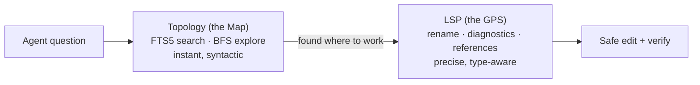

# Topology — plumb's semantic code index

## What is it? (start here)

When you open a large codebase for the first time, the hard part isn't reading
any single file — it's knowing *where things are* and *how they connect*.
**Topology is plumb's answer to that.** It is a small, local database that plumb
builds from your code and keeps up to date in the background. It records the
*structure* of your project — every function, type, method, route, and test, and
the relationships between them (which function calls which, which file imports
which) — so questions like:

- "Where is the routing / auth / database logic?"
- "What calls this function, and what would break if I change it?"
- "Which tests cover this area?"

can be answered **instantly**, without reading the whole repository and without
waiting for any heavy tooling to start.

The name comes from *topology* in the mathematical sense — the shape of how
things are connected. Plumb's topology is a **graph** of your code's entities
(the nodes) and their relationships (the edges), stored in a single file that
plumb can rebuild from scratch at any time.

> **You don't need to understand any of the internals to use it.** It is **on by
> default** — the `topology_*` tools (plus faster symbol search) work out of the
> box; opt out with `[topology] enabled = false`. The rest of this page explains
> the benefits and how it works, for the curious.

## Why it exists — the problem it solves

On an unfamiliar codebase, agents and developers hit the same bottleneck:
**discovery is expensive.** The usual options each fall short:

- **Read files** — accurate but slow and token-hungry; you read a lot to find a
  little.
- **Grep / text search** — fast but blind: no ranking, no idea whether a match
  is a definition, a comment, or a call, and no sense of structure.
- **Ask the language server (LSP)** — compiler-grade precision, but it must boot
  and index first (seconds to minutes on a cold or large project), needs the
  right server installed, and wants the code in a compilable state.

Topology fills the gap: **broad, structural answers, available immediately** —
even before (or entirely without) a language server, and even when the code
doesn't compile. For an AI agent that is a big token-efficiency win: it can pinpoint
the right few files instead of reading dozens.

## Benefits at a glance

- **Instant.** Answers come from a local SQLite/FTS5 database — no
  language-server boot, no per-conversation indexing wait.
- **Works without a language server.** Useful for any project where the relevant
  language server isn't installed, and for config/markup formats that have no LSP
  at all.
- **Tolerant of broken code.** It's syntactic, so it keeps working mid-refactor
  when the code won't compile.
- **Structural, not just textual.** Ranked symbol search, neighbourhood
  exploration, and blast-radius/impact analysis — things grep cannot do.
- **Cheap and self-throttling.** A small file under `.plumb/`, maintained by a
  background indexer that paces itself so it never hogs a CPU core.
- **Rebuildable.** It's derived data. Quit your MCP clients (a connected
  `plumb serve` restarts the daemon), run `plumb stop` until the daemon is not
  running, then delete `.plumb/topology.db` and its `-wal`/`-shm` sidecars, and
  plumb rebuilds it on the next start. Don't delete it under a running daemon:
  the daemon keeps writing to the deleted file and nothing rebuilds until it
  restarts. See [Troubleshooting](troubleshooting.md). (plumb also keeps it out
  of git automatically.)

The trade-off — a deliberate one — is that topology is *approximate*: it
understands syntax, not full type semantics. That's why plumb pairs it with the
language server.

## The dual-engine model: Map + GPS

Plumb pairs two engines that handle different phases of an agent's work:

- **Topology is the Map.** Use it for discovery: "where is the routing logic?",
  "what's around this symbol?", "what does changing this touch?". It answers
  immediately, tolerates broken code, and has a tiny memory footprint — but it
  is syntactic (Go AST; pure-Go tree-sitter for TypeScript/TSX/JSX, Python,
  Ruby, C, PHP, JSON, CSS, SCSS, XML, Lua, C++, Objective-C, Dart, JavaScript, Rust, Zig, Kotlin, Java, Bash, HCL, SQL, Dockerfile, TOML,
  YAML and Markdown; and canonical-grammar WASM for Swift), so it offers
  *broad recall*, not compiler-level precision or type resolution.
- **LSP is the GPS.** Once you know *where* to work, the language-server tools
  (`get_definition`, `find_references`, `rename_symbol`, `diagnostics`) make and
  verify changes with full type awareness.

See [Architecture → dual-engine](architecture.md#plumb-topology-vs-lsp-the-dual-engine-architecture)
for how the two fit into plumb's layered design.

### Languages the Map does not cover

**There are currently none.** Every language plumb recognises now has an
extractor, so `topology_status` has no coverage gap to report. This section
stays because the machinery does, and because the next language added will need
it.

For a language plumb recognises but has no extractor for, the files are still
recorded and contribute no symbols. That gap is reported rather than left to be
inferred, because an empty Map result is otherwise indistinguishable from a
codebase that genuinely has nothing in it:

- `topology_status` lists it as `not covered: xml (330), json (312)`, busiest
  first, and no longer counts those files under `indexed files`.
- `file_outline` on such a file says so instead of printing a bare `(no symbols)`.
- `session_start` warns when the workspace's *primary* language is one of them.

`search_in_files` and `read_file` work on every language regardless, and an
attached language server still answers hover and definition queries.

Wiring a language is a flip from `EngineNone` to `EngineTreeSitter` in
`internal/langsupport` plus an extractor constructor — the registry doubles as
the coverage roadmap. Because an uncovered file is stored with an empty content
hash, adding an extractor makes every such file stale automatically and the next
resync picks it up; no reindex flag or schema change is needed.

## How it works (architecture)

You can skip this section and still use topology happily. For the curious, the
pipeline has four parts:

1. **Extractors read your source.** Per language, a lightweight extractor turns
   a file into a list of *entities* (functions, types, methods, imports, tests)
   and *edges* (calls, imports, containment). Go uses the standard library's
   `go/parser` + `go/ast` (precise, no cgo); Python, Ruby, C, PHP, JSON, CSS, SCSS, XML, Lua, C++, Objective-C, Dart, Rust, Zig, Kotlin, Java,
   JavaScript (`.js`/`.mjs`/`.cjs`), TypeScript (`.ts`) and TSX/JSX
   (`.tsx`/`.jsx`) use the pure-Go gotreesitter runtime; Swift uses the
   canonical tree-sitter grammar compiled to WASM and run via wazero, until
   the remaining upstream gotreesitter Swift parse gaps close.
   None of this requires the code to compile.
2. **A SQLite + FTS5 database stores the graph.** Entities and edges live in
   tables in `<workspace>/.plumb/topology.db`; an FTS5 (full-text search) virtual
   table powers ranked, typo-tolerant symbol search and splits
   `CamelCase`/`snake_case` so `UserSession` matches both `user` and `session`.
3. **A background indexer keeps it fresh.** One goroutine per workspace: every
   plumb write re-indexes just that file, and a periodic full resync (hourly by
   default) reconciles anything changed outside plumb — a `git pull`, a branch
   switch, another editor. The full resync is **throttled** (it pauses briefly
   every `resync_batch` files) so a large repo's index build never saturates a
   core or competes with your live tool calls; the pause is interruptible so
   daemon shutdown stays fast. The resync walk **prunes** three ways, additively:
   a hardcoded floor (`vendor`, `node_modules`, `testdata`, `dist`, `build`,
   `__pycache__`, and every dot-directory), the tree's own `.gitignore` /
   `.ignore` files, and `exclude_patterns`. Editing a `.gitignore` triggers a
   full resync, so a newly ignored tree is un-indexed (the prune pass removes
   rows for files the walk no longer visits) and a newly un-ignored one is
   picked up. A cycle that fails (a database error, say) is retried on its own
   as a full resync, with backoff from 30 seconds doubling to 30 minutes, until
   one succeeds. Until then `topology_status` flags the index `FAILING`, and
   every answer from `topology_search`, `topology_explore`, `topology_impact`,
   `topology_affected`, `topology_routes` and `structural_query` leads with a
   `⚠ STALE INDEX` notice: it is served from the last good snapshot, so an
   absence in it is not evidence of absence. The same notice rides on the LSP
   tools' own fallbacks — `workspace_symbols`, `read_symbol`, `get_definition`,
   `call_hierarchy`, `file_outline`, and the index-supplemented "fill" results —
   because those answer from the same snapshot whenever the language server
   cannot. The web API reports the state as `failing`, but only from a LIVE
   indexer: `failing` is a property of the indexer, not of the database, so a
   reader with no indexer attached (the TUI, `plumb doctor`, an out-of-process
   `plumb web`) sees `indexerState: "stopped"` and must read `failing` as *not
   known* rather than as healthy.
4. **Six tools query the graph** (below), reporting their source and freshness so
   an agent never mistakes an approximate answer for compiler-grade truth.

In plumb's layered architecture, topology is the **Intelligence** layer
(`internal/topology`), sitting below the application/presentation layers and
beside the domain layer — it never depends on higher layers, and other layers
treat it as an optional, rebuildable index.

## When to use topology vs LSP

| You want to… | Use |
|---|---|
| Find where a concept/feature lives | `topology_search` |
| Understand a symbol's neighbourhood | `topology_explore` |
| Assess the blast radius of a change | `topology_impact` |
| Know which tests a change might affect | `topology_affected` |
| Gather a task's seeds, bodies, neighbourhood, affected tests and constraints in one bounded call (experimental, unpinned) | `context_for_task` |
| Find entry points: route → handler registrations and the Cobra command tree | `topology_routes` |
| Jump to a definition with certainty | `get_definition` (LSP) |
| Find every real call site | `find_references` (LSP) |
| Rename safely across the workspace | `rename_symbol` (LSP) |
| See compile errors | `diagnostics` (LSP) |

A common flow: `topology_search` to locate → `topology_explore`/`topology_impact`
to scope → LSP tools to read and edit precisely → `diagnostics` to verify.

When topology is enabled, the name-lookup tools `workspace_symbols`
and `file_outline` also **fall back** to the topology index
if the language server errors or times out, returning approximate results
annotated `source=topology, mode=indexed-approximate` rather than failing.

## The six tools

See [Tools → Topology](tools.md#topology) for full inputs. In brief:

- **`topology_status`** — index health: file/entity counts, DB size, indexed
  languages, last sync, last error, and a `FAILING` flag while the last
  indexing cycle has errored. (`plumb doctor` also reports this.)
- **`topology_search`** — FTS5 ranked symbol/file search (`query`, optional
  `kinds`/`language` filters).
- **`topology_explore`** — BFS neighbourhood around a named symbol, with depth,
  node, and byte budgets.
- **`topology_impact`** — bidirectional blast radius: what a symbol depends on,
  and what depends on it. `mode: "reachability"` switches to the reachability
  contract below; `granularity` selects package (the default) or Go function.
- **`topology_affected`** — *the headline.* Given changed files/symbols, the
  files and tests most likely affected, by inward dependency edges **and**
  co-location (tests in the same directory as a changed/affected file — catching
  sibling test files the call graph alone misses). Recall-biased; each test
  carries a confidence (1.0 containment, 0.8 dependency edge, 0.5 co-located)
  and the reason it was flagged. Use after writing to decide what to run.
- **`topology_routes`** — recovers entry points from registration sites recorded in
  the index: route string → handler for Go `net/http`, gorilla/mux, chi, gin and echo,
  Python Flask/FastAPI decorators, and the Cobra command tree (`Use` → `Run`/`RunE`,
  linked through `AddCommand`). See [Route recovery](#route-recovery) below.

`context_for_task` ([Tools](tools.md#context_for_task); experimental and unpinned) is a
consumer of the index rather than a seventh topology tool. It reads the index of the
*calling agent's* canonical root, not the connection's, and it uses the same facts the
tools above do: nodes and edges for the walk, the evidence class of each edge (extractor,
derived, heuristic) as a rank and a label, `topology_affected`'s test gather, and the
heading nodes of Markdown for document sections. Two rules are specific to it. A body is
sliced from the index's line span only if the content hash the index held *when it gave
the span* equals the hash of the file snapshot the body is cut from; otherwise the
declaration is found again in the snapshot. And while the index is `FAILING`, absent or
another root's, it claims no relationship and no test impact, and says so.

## Package-level reachability

`topology_impact mode="reachability"` answers a different question than the rest of
this page, at selectable granularity: package mode asks **"what does this *binary*
(or entry point) pull in, and which packages are unreachable?"**; function mode asks
**"what does this callable root pull in?"**. Package mode is built entirely on the
`imports` edges `linkImports` already produces; function mode uses the admitted Go call
resolver edges. There is no schema change or new tool (`topology_impact` gained a
`mode` and `granularity` rather than adding to the tool count).

**Granularity, stated plainly.** Reachability defaults to `granularity="package"` and
opens with `package-level (import edges, production imports only — Go _test.go importers
excluded)`. This is directory-level closure over production import edges. Opt into
`granularity="function"` for Go-only outward closure over admitted call-resolver edges;
its header says `function-level`, test-file callers are excluded, and unresolved
receiver/dynamic/external calls are disclosed as a lower bound. Function mode answers
"is this callable reachable from these roots", not proof of dead code. Treat a small
unreachable package or callable as a lead to verify before deleting; reflective or
dynamic use can still exist outside the indexed graph.

**Production imports only.** An edge whose importer is a Go `_test.go` file is excluded
from the graph, on purpose. Go forbids real import cycles, so any cycle a naive version
of this feature could report was necessarily a `_test.go`-only artefact — measured on
plumb's own index, 64% of the folded edges originated in a test file, and every cycle an
early build of `layers` reported vanished once those edges were excluded. The
consequence for the default shape: a package pulled in only by a sibling package's test
file (a test helper, a fixture) is reported **unreachable**, which is the intended
answer to "what does the binary pull in" — it never ships. **This cuts both ways, and
the destructive direction is undisclosed nowhere else but here without this sentence:**
on plumb's own index, `internal/lsp/conformance` and `internal/lsp/lsptest` — real,
in-use test-support packages — show up in the unreachable list precisely because
nothing but a `_test.go` file imports them. The response's `unreachable` line says so
directly: *"a package used only by tests appears here by design — confirm before
deleting."* Treat every unreachable result as a lead to verify, not a deletion list.

**Build-tag-excluded files are still indexed, and still counted.** The extractor is
syntactic (`go/parser`), not build-aware: a file gated to another OS/arch (e.g.
`foo_linux.go` on a macOS index) is parsed and its imports folded into the graph
regardless of whether the current build would ever compile it. A package reachable only
through such a file may be reported reachable on a platform where it is not actually
built — check `go list` or the build tags directly before trusting a borderline result.

**Go-only, for now.** Folding edges into this graph needs a package node to carry its
own outward `imports` edge to an import node in the same file — today only the Go
extractor (`extractors/golang`) emits that shape. On a workspace whose primary language
doesn't (C#, PHP, Scala, Elixir, …), `mode="reachability"` detects the case and refuses
with a clear message rather than reporting every package "unreachable", which is what an
unguarded version of this feature did. The detection is deliberately not "zero foldable
edges" alone — a genuinely small Go workspace can have zero too (every cross-package
import is stdlib-only, or its only cross-package import lives in a `_test.go` file,
which is excluded per the production-imports-only rule above); the refusal fires only
when the index ALSO carries no independent evidence of Go — specifically, no `package`
node with `language=go`. That check is deliberately narrower than "no `import` node at
all": C#, PHP, Elixir, and Scala — the four non-Go languages whose extractors can
populate a directory at all — each emit their own `import`-shaped nodes too, so a
broader "any import node" signal would have made the refusal unreachable for every
workspace it exists to catch. A Go `package` clause is mandatory and per-file, so a
`language=go` package node is unambiguous evidence no other extractor produces.

In a polyglot workspace, the package graph used for this answer contains only Go
package directories and import edges between them. Other languages' package
declarations are counted as out of scope in the response, even when they share a
directory with Go source; they are never listed as unreachable. A `path_to`
request for a non-Go package directory reports it as out of scope.

**Roots.** Package granularity starts from every `package main` directory by
default, plus `topology_routes` entry-point candidates (labelled
`candidate-seeded`, since route results are name/signature heuristics). Pass `roots`
to override with package directories or the literal `"main"`. Function granularity
uses the corresponding `main` functions plus route candidates by default; explicit
roots are canonical `file.go#Symbol` selectors or `"main"` (a unique bare symbol
name is accepted as a convenience).

**Three response shapes**, each capped at 4,800 bytes:

- **default** — reachable/unreachable counts and up to 10 deterministic samples per
  bucket. Package mode sorts unreachable packages by indexed size; function mode lists
  reachable and not-reached callables and says that the latter are not proof of dead code.
- **`path_to`** — the single shortest root → target chain. Use a directory for package
  mode or `file.go#Symbol` for function mode; an honest "no path" is returned when the
  target is not reached.
- **`layers: true`** — a Tarjan SCC condensation in topological layers. Multi-package
  components are import cycles; recursive multi-function components are call cycles,
  both flagged `[cycle]`.

**Correctness note for the curious.** Computing "unreachable" correctly requires the
*full* transitive closure from the roots, not a bounded neighbourhood — a depth-capped
walk would silently misreport a genuinely reachable package as unreachable on any
dependency chain longer than the cap, which is the false-negative direction this
feature is built to avoid. The package traversal therefore runs to full closure over a directory-level graph
folded from the same `imports` edges, and function mode runs to full outward closure over
its admitted Go call graph. Neither reuses the depth/byte-capped symbol-neighbourhood BFS
used elsewhere in this page.

## Cross-file call edges (Go only)

The index records **call sites** — every call expression, resolved or not — in
`topology_call_sites`, and a resolver turns five shapes of them into cross-file `calls`
edges tagged `source = "call-resolver"`. Extractors run per file and emit edges as
indices into that file's own node slice, so nothing they produce can name a symbol in
another file; every cross-file call edge comes from this resolver.

**Read the reach number before you read the graph.** Measured on plumb's own tree
(1,849 indexed files, Go only):

| | |
|---|---:|
| recorded Go call sites | 138,355 |
| call sites resolved into cross-file `call-resolver` edges | **24,072** |
| …package-qualified `pkg.F()` | 3,761 |
| …bare same-package `F()` | 12,969 |
| …on the method's own receiver `r.M()` | 1,038 |
| …on a typed parameter `p.M()` | 462 |
| …on a local variable of evident type `x.M()` | 5,842 |
| …with a non-`_test.go` caller | 5,559 |
| **share of all call sites resolved across files** | **17.4%** |
| same-file calls the extractor links directly | 14,507 (10.5%) |

Every call site lands in exactly one bucket, and the eight add up to the 138,355 above —
that is what makes this a measurement rather than an impression:

| call-site bucket | |
|---|---:|
| resolved into a cross-file edge | 24,072 |
| method call on another receiver (a field chain, a returned or indexed value, a local of no evident type), left unresolved | 48,616 |
| qualified call leaving the indexed tree (stdlib, third party) | 30,328 |
| bare call naming no function of the package (builtin, local value, conversion) | 14,850 |
| bare or receiver call whose target is in the same file (the extractor's edge) | 14,507 |
| repeat of a caller→target edge already emitted | 5,976 |
| names no exported top-level function in the target package | 6 |
| no enclosing declaration to hang the edge on | 0 |

**How good the edges are.** Checked against the Go type checker (`go/packages`) on every
edge, not a sample, none is wrong: 3,531 of 3,531 judgeable package-qualified edges and
19,778 of 19,778 from the four newer tiers (the rest point at a file the type checker
did not load for this platform). An independent check found none wrong on the Go standard
library or `golang.org/x/tools` either. Two extractor markers are what keep it there: a
call on a receiver with no name (`f().M()`, `x.(T).M()`, `r[k].M()`) is never read as a
bare call, and a bare call of a name the function declares itself (`walk := …; walk()`)
is counted as a local value, not linked to the package function of the same name. Of the
cross-file caller→callee pairs the type checker finds, the graph holds **85.5%**: every
function call, same-package or not, 69% of same-package method calls and 43% of
cross-package ones.

`topology_status` prints these for your own workspace. The Go extractor parses with
`SkipObjectResolution`, so the index carries no type flow beyond what one declaration
states: a method call on a *field*, on a value returned without being named, or on a local
whose type no single declaration states cannot be tied to its type, and those edges are
**absent and counted**, never guessed — 20.8% of plumb's own callables share a name with
another callable, so textual receiver matching would manufacture wrong edges at scale.

**What resolves.**
- *Package-qualified.* `pkg.Fn()` whose `pkg` is an import of *that same file*, whose
  import path names a directory the index holds, and whose `Fn` is an exported top-level
  function declared there. Per-file import sets are the precision story. An unexported
  callee behind a qualifier is treated as a receiver call, because a local variable can
  shadow an import name.
- *Bare same-package.* `Fn()` linked to a top-level function of the caller's own
  directory **and package clause**, so an external `foo_test` package never reaches
  `foo`'s functions. A function with build-tag variants (`x_linux.go`, `x_darwin.go`)
  gets an edge to each. A builtin, a conversion or a local closure is no top-level
  function and is counted, not linked.
- *Receiver-self.* Inside `func (r *T) M()`, a call `r.N()` is linked to `T`'s method
  `N` in the same package: the declaration names `r`'s type.
- *Typed parameter.* Inside `func f(st *Store, db *db.DB)`, `st.Get()` and `db.Query()`
  are linked to the parameter type's method — the caller's own package for `Store`, the
  imported package for `db.DB` (exported methods only). A parameter shadows an import of
  the same name, as in Go.
- *Local variable of evident type.* `x.M()` where the function declares `x` once as
  `x := T{}`, `&T{}`, `new(T)`, `var x T`, `x := y.(T)`, or `x := F()` / `x, err :=
  pkg.F()` — the last two read through `F`'s declared results (an exported `F` and an
  exported method across packages). A name the function declares more than once (a loop
  variable re-declaring a parameter, `:=` in two blocks) is ambiguous: no tier reads a
  type for it, the receiver-self and parameter tiers included.

The last four carry confidence **0.85** (the qualified tier 0.9). A local's type hint is
dropped when its leading name is one the function declares itself (a parameter named like
an import, a local closure, a local type, a type parameter) other than the variable itself
(`store := store.Open()` keeps it), and a site the local tier cannot resolve keeps the
package-qualified reading when its qualifier is an import and not also the receiver or a
parameter (`rand := rand.New(src)`). Their residual false edges are known shapes, none
seen on plumb's tree, the Go standard library or `golang.org/x/tools`: a local named like
an import whose method is promoted from an embedded type (`store := &store.Wrapper{};
store.Query()`), which that fallback reads as the package's function, as the qualified
tier always has; a package-level variable
used outside the block of a same-named local declared once (declarations are counted
per function, not per block); a parameter type named like a type parameter
(`func F[Store any](s Store)`), since type parameters are not in the stored signature;
several `//go:build ignore` `package main` programs in one directory, which share one
package key; and a directory with more than one non-test package clause, where an
import resolves to the last one seen. A target in the caller's own file is left to the
extractor's intra-file edge rather than written twice.

One shape is invisible to this: Go does not require a package's name to match its
directory, and for an *unaliased* import the index derives the local name from the import
path's last element. A call qualified by a package whose name differs from its directory
(`internal/utils` declaring `package util`) therefore misses the file's import set and is
counted as a method call on a receiver, which it is not. It is a missing-edge and
mis-label case, never a false edge, and plumb's own tree has zero of them. Explicit import
aliases resolve correctly.

**Test callers are included, and the split is published.** A test calling the function it
exercises is the most useful cross-file call edge there is, so `_test.go` callers are
resolved and counted; the non-test subset is reported alongside so a consumer that must
exclude them (import-cycle reasoning, for one) can filter on the caller's path. This is
the opposite of `mode="reachability"`'s production-imports-only rule, deliberately: that
rule exists because Go forbids import cycles, and a call edge implies no such constraint.
Vendored and generated code follow the index's existing rule and get no special case —
`vendor/`, `node_modules/`, `testdata/`, `dist/` and `build/` are excluded from the walk,
and everything else that is indexed contributes call sites.

**The lifecycle is durable, and consumers opt in deliberately.** Derived edges survive
incremental re-indexes: callee re-indexes repoint incoming rows by stable identity, while
caller re-indexes replace only outgoing rows. Because the same-package tiers link only
within one directory, a scoped pass widens from the changed files to every file in their
directories, so a function added to one file reaches an unchanged sibling's call. A target
another package can reach (an exported function or method) is part of the resolver
surface: adding, removing or renaming one forces a full pass. Function reachability
opts into admitted Go resolver edges, filters `_test.go` callers, and computes full
outward closure. The neighbourhood traversal still excludes derived calls by **source**:
`ExploreOpts.IncludeDerivedCalls` defaults to false. `context_for_task`,
`call_hierarchy`'s topology fallback, `topology_affected` and `minimal_diff_review` opt in
node by node, asking the admission rule (supported language, and a package node in the
index) on the node they walk around. Excluding by edge *kind* would not work: derived
edges are `calls` edges, identical in kind to the extractor's own.

**Language admission.** A language is served iff it is in the resolver's compile-time
supported set (today exactly `{go}`) **and** the index holds a `package` node with that
language. Both terms are positive: no edge count, no coverage ratio, no "primary
language" heuristic. The *subject* of a query — the symbol or file asked about — selects
which language's admission is consulted, so a repository that is 90% TypeScript with one
`tools/gen.go` gives the Go subject a normal Go answer and the TypeScript subject an
honest refusal, and neither answer silently includes the other language's files. A
traversal admitted for one language never crosses into another's nodes; those are
reported *out of scope*, which is a different fact from having no callers.

For a language that is refused, the alternatives offered depend on whether plumb ships a
language server adapter for it: with one, `find_references` and `call_hierarchy` answer
the cross-file question properly through the server; without one, `search_in_files` over
the symbol name is the honest tool and the refusal says so rather than implying a server
exists. Package-level reachability is **not** offered as the coarser answer, because it
is gated to the same language set.

## Route recovery

`topology_routes` reads REGISTRATION sites — the call, composite-literal field or
decorator that binds a route string to a handler — from `topology_call_sites`, the
same table the cross-file call resolver uses.

| Family | What is read | Handler |
|---|---|---|
| Go `net/http`, gorilla/mux, chi | `Handle`/`HandleFunc(pattern, h)`; chi's `Get`/`Post`/… | the argument after the route |
| gin, echo | `GET`/`POST`/…/`Any` with a literal `/…` route | gin: the last argument (middleware comes first); echo: the one after the route |
| Cobra | each `&cobra.Command{Use: …, RunE: …}` literal, linked by `parent.AddCommand(child, …)` | the `RunE` (else `Run`) field |
| Flask, FastAPI | `@app.route("/x")`, `@router.get("/x")`, … | the decorated function itself |

A site counts only when the registering file imports that framework (qualify by import,
never by a bare method name), and a qualifier that is an import of some other package
is rejected — `http.Get("/x")` in a chi file is a client call. Registrations in test
files are fixtures and are skipped. Go 1.22 `"GET /items/{id}"` patterns are split into
method and route.

Each handler carries a label, never a probability:

- `resolved` — `pkg.Handler` resolved through the file's own import to that package's
  top-level function.
- `same-package` — a bare name, matched to the package's top-level function of that
  name (a local variable of the same name would shadow it).
- `decorated` — Python: the handler is the decorated declaration.
- `name-match` — a method value (`s.handleX`) matched to the package's only method of
  that name; the receiver's type is not checked.
- `ambiguous` — several candidates; none is chosen.
- `external` — a handler in a package outside the index (`http.NotFound`).
- `unresolved` — an inline function, an expression, or a name no declaration carries.

What it does not do: compose router group or mount prefixes (`r.Route("/api", …)`,
`r.Group("/v1")`) — each route is reported with the string written at its own site; read
a route that is not a string literal (it is shown as `<dynamic>`); or link a Cobra child
passed as a factory call or a local variable (counted and disclosed as unlinked, and the
command is listed at top level). Argument positions are rebuilt only when every
argument is the route literal or a name; otherwise no handler is named rather than the
wrong one. Swift (Vapor, ArgumentParser) records no call sites, so it — and any framework
with no recovered site — falls back to the older name/signature candidates, labelled
`name-match`.

## Configuration

All `[topology]` fields (see the
[Configuration reference](configuration.md#topology--semantic-index)):

| Field | Default | Effect |
|---|---|---|
| `enabled` | `true` | Turn the index on or off (on by default). |
| `resync_on_attach` | `false` | Full resync each time the workspace attaches. |
| `exclude_patterns` | `[]` | Extra path globs the indexer and watcher skip, on top of the hardcoded skip list and the tree's own `.gitignore` / `.ignore`. For a vendored or generated tree the repository tracks on purpose — the one exclusion the other two cannot express. `third_party/**` matches a path, `*.pb.go` a base name at any depth. A pattern matching every path is refused — probed through the matcher itself, so respellings (`**/**`, `?*`) are caught too; use `enabled = false` instead. Gated on `plumb trust`, because a pattern hides named files from every topology query while the index still looks healthy. |
| `max_file_size_bytes` | `524288` | Largest file considered (512 KiB). |
| `extract_timeout_seconds` | `10` | Longest one file's parse may run before it is abandoned and recorded as a file error. The size caps above bound how much source a grammar sees, not how long it spends: error recovery can go superlinear on a small file, and the indexer runs a single worker, so an unbounded parse would stall every file behind it. Bounded by a built-in 2-minute ceiling: this setting can LOWER the bound but not remove it, since an unbounded parse can wedge the single indexer worker permanently, so `0` means "use the ceiling" rather than "unbounded". A file that times out is recorded with its mtime (not a content hash), so every full resync re-attempts it and re-pays the full timeout — a pathological file costs one timeout per resync cycle. |
| `resync_batch` | `100` | Files extracted before the full resync pauses (CPU throttle). `0` disables pacing. |
| `resync_pause_ms` | `25` | Pause after each `resync_batch` files, in milliseconds. `0` disables pacing. |
| `resync_interval_minutes` | `60` | Periodic full-resync **fallback** (used only when `watch = false` or the watcher can't start); suppressed while the watcher is live; `0` disables. |
| `watch` | `true` | OS-level file watching: re-index a file the moment it changes on disk, regardless of who changed it (agent, another agent, your editor). Replaces polling; falls back to `resync_interval_minutes` when disabled or unavailable. |

The index is enabled per project or globally. It writes only to
`<workspace>/.plumb/topology.db` (and its SQLite `-wal`/`-shm` sidecars), which
plumb adds to `.plumb/.gitignore` automatically so the rebuildable index is
never committed.

## Trade-offs and limitations

- **Syntactic, not semantic.** Topology does not resolve types or follow dynamic
  dispatch. Treat its graph as a strong hint, then confirm with LSP.
- **Cross-file call edges cover about 17% of call sites, in Go only** (about 85% of the
  cross-file caller→callee pairs a type checker finds). See the section above: a method
  call on a field, an unnamed value or a local of no single declared type carries no type
  in a syntactic parse and is left unresolved by design, so a caller list from the
  topology call graph is a lower bound and never a complete one, weakest for methods
  across packages. Confirm with `find_references`.
- **`topology_routes` recovers what is written at the registration site, untyped.**
  Handlers are tied by import and package scope, never type-checked; router group and
  mount prefixes are not composed; Swift and frameworks with no recorded site fall back
  to `name-match` candidates. Always read the handler label.
- **Freshness is eventual.** Edits made through plumb re-index immediately;
  external changes are picked up by the periodic resync (or on the next attach).
- **Enabled by default.** Opt out with `[topology] enabled = false` (per-project
  or global) — e.g. for a very large repo you do not want indexed. On first
  attach the index is created at `<workspace>/.plumb/topology.db` (auto-gitignored);
  this is the one case where plumb materialises `.plumb/` for a project.
